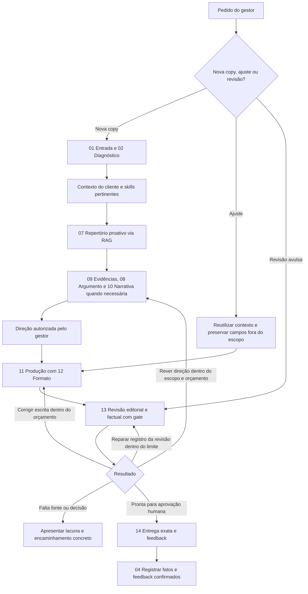
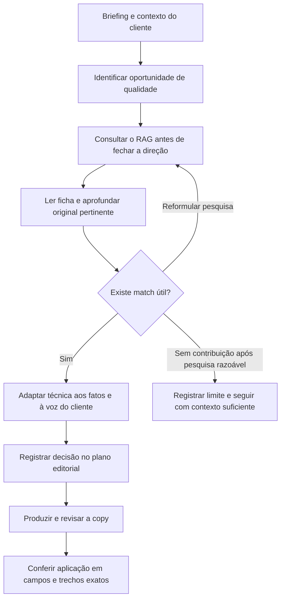

# Copywriting Agent

Agent inspirado na metodologia da Thamy para produzir copy específica a partir de briefing, contexto do cliente e evidências. Funciona no Claude Code e no Codex, com **1 agent + 14 skills** e quatro rotas: landing page, social orgânico, anúncios e mensagens/e-mail.

A estrutura atual inclui seleção autônoma de skills, repertório proativo via RAG local, controle de redundância e revisão com tentativas limitadas. Frameworks ajudam a organizar um argumento quando necessário; não determinam a estrutura de toda peça.

## Requisitos e instalação

- Claude Code ou Codex configurado.
- Python 3.10+ para os verificadores objetivos e a recuperação lexical; essas partes usam somente a biblioteca padrão.
- Python 3.11+ para as dependências semânticas fixadas em `requirements-rag.txt`. O ambiente validado usa Python 3.13.7. A instalação opcional está em [Instalar o RAG semântico](#instalar-o-rag-semantico).
- Fontes de cliente locais ou integração de Drive disponível no ambiente. O projeto não instala nem autentica um conector.

```bash
git clone https://github.com/davigraeff-v4/copywriting-agent.git
cd copywriting-agent
python3 -m unittest discover -s tests -v
```

Abra a pasta no Claude Code ou Codex. Eles usam respectivamente `CLAUDE.md` e `AGENTS.md`. Sem Python, o agent pode diagnosticar e rascunhar, mas deve indicar que a verificação objetiva está pendente.

### Primeiro chat

No primeiro chat de uso do projeto, o agent deve verificar o ambiente, explicar brevemente os modos de recuperação e informar como instalar o RAG semântico caso ainda não esteja disponível. Essa orientação está também em `AGENTS.md` e `CLAUDE.md`, para não depender de o usuário encontrar esta seção.

Você pode começar assim:

> Verifique o ambiente deste projeto. Informe se o RAG semântico está funcionando e, se faltar alguma coisa, explique como instalar. Depois seguimos com o briefing.

O agent confere o Python disponível, dependências, cache do modelo, integridade dos índices e uma consulta real. Ele deve distinguir **semântico ativo**, **somente lexical disponível** e **base indisponível**, indicando a causa observada. Se já estiver funcionando, basta confirmar; não repetir instalação, download ou reconstrução. Instalar pacotes e baixar pesos só acontece quando solicitado ou autorizado. A orientação inicial não cria uma aprovação adicional para produzir copy e não bloqueia o uso lexical quando a base está íntegra.

## Uso diário

Cole o briefing ou peça a peça desejada. O agent consulta o estado do cliente, informa modo e rota, reúne lacunas materiais e propõe uma direção com o argumento e a função de cada seção ou pauta. Após autorização, entrega a copy revisada e registra seu feedback.

Exemplos de pedidos:

- “LP de cinco dobras, formulário na primeira, para cadastro de oficinas que ainda não conhecem a marca.”
- “Calendário de seis posts para seguidores. Use os bastidores disponíveis e explique o valor de cada pauta.”
- “Criativo estático com headline única. Preserve a restrição de nomenclatura do cliente.”
- “Revise esta copy e aponte o trecho e o motivo de cada problema.”

Você continua recebendo texto legível. Arquivos de contexto, revisões e verificações são trabalho interno do agent.

### Fluxo do agent



As skills 03, 05 e 06 aprofundam marca, público e consciência quando necessário; a 04 registra memória ao longo do trabalho. A direção pode seguir sem nova pausa quando já houver autorização explícita para isso. Ajuste estratégico volta ao contexto/direção; ajuste localizado preserva decisões válidas. Um bloqueio pode exigir corrigir escrita, direção, fontes ou o registro da revisão. O limite é a versão inicial mais duas reescritas por direção e até dois reparos de revisão no ciclo inteiro. Os scripts controlam esses registros; o agent executa as ações. Aprovação humana não publica a copy.

## Modos

| Modo | Quando usar | Interação |
|---|---|---|
| Rápido | Padrão | Até três checkpoints: lacunas, direção e entrega |
| Express | Cliente conhecido e demanda recorrente | Direção compacta e entrega |
| Estratégico | Quando você pedir construção passo a passo | Decisões pertinentes detalhadas |

As 14 skills são capacidades, não 14 pausas obrigatórias. O agent seleciona e lê as pertinentes conforme `quality/AUTONOMIA-E-REPERTORIO.md`; `scripts/context_trace.py catalog` facilita a descoberta. Na produção nova, o RAG é pesquisado proativamente para melhorar a construção mesmo com briefing completo, com leitura integral e aplicação rastreada. Redundância segue `quality/REDUNDANCIA.md`, preservando retomadas úteis e exigindo evidência para descontos. Uma autorização explícita para executar sem pausa dispensa reconfirmação da direção naquela tarefa. Informação indispensável ausente ainda precisa ser resolvida. O contrato completo fica em `CONTRATO-OPERACIONAL-MODOS.md`.

## Comandos

| Comando | Comportamento |
|---|---|
| `/copy-final` | Inicia a partir do briefing; aceita `--rapido`, `--express`, `--estrategico` |
| `/copy-lp` | Argumentação de landing page |
| `/copy-social` ou `/calendario` | Pauta ou calendário orgânico |
| `/revisar-copy` | Crítica da versão atual, linguagem, argumento e fatos |
| `/aprovar-copy` | Registra aprovação expressa da versão revisada |
| `/reprovar-copy` | Registra motivo e aprendizado |
| `/ajustar-copy` | Corrige uma versão existente, preservando contexto e campos não afetados |

Esses comandos têm arquivos em `.claude/commands/`. No Codex funcionam como convenções de texto. `/copy-meta`, `/copy-google`, `/copy-criativo`, `/copy-carrossel`, `/copy-video`, `/copy-whatsapp` e `/copy-email` são convenções adicionais; canal e formato não determinam sozinhos o objetivo.

## Memória e contexto

- `clients/{cliente}/CLIENTE.md`: estado consolidado, voz, restrições com escopo e pendências de validade.
- `clients/{cliente}/APRENDIZADOS.md`: decisões e cronologia; correções recentes prevalecem sobre resumos antigos.
- `clients/{cliente}/campanhas/{campanha}/vN/`: contexto, copy canônica, revisão e feedback daquela versão.
- `clients/{cliente}/fontes/`, `referencias/`, `assets/`, `historico/legado/`: materiais do cliente e originais preservados.

`python3 scripts/client_brief.py {cliente}` reúne contexto e feedbacks sem inferir aprovação. Clientes não migrados continuam legíveis pelo layout anterior. `scripts/migrate_clients.py` oferece plano, aplicação com backup, verificação por hash e rollback; instruções em `knowledge/memoria-clientes.md`. O mapa de caminhos é local e privado.

Arquivos reais ficam locais, ignorados no Git. Um clone novo contém estrutura, templates e exemplos técnicos fictícios; não contém fichas e curadoria privadas desta máquina. Ver `clients/cliente-template/CLIENTE.md`, `clients/cliente-template/APRENDIZADOS.md` e `knowledge/memoria-clientes.md`.

## Como a qualidade é verificada

1. Argumento e pauta partem do briefing e de fatos selecionados. Cada dobra responde a uma pergunta; cada post precisa ter valor específico e produção viável.
2. `quality/editorial-policy.json` define bloqueios literais e alertas: abreviações coloquiais, travessões, falso contraste, sequências telegráficas e repetição entre campos.
3. `scripts/copycheck.py` confere estrutura, claims ligados a fontes, restrições, limites por campo e formulários. A revisão editorial precisa citar trechos exatos e registrar conferência factual.
4. O código calcula os scores. Mudança na copy, contexto, política, rubrica ou verificador invalida a revisão anterior. Cada campo recebe decisão factual e cada fonte tem arquivo/snapshot de texto, hash e trecho verificável. O texto final é renderizado da mesma versão revisada. Revisões históricas ficam preservadas, mas precisam ser renovadas para novo render ou derivação sob o gate de 2026-10-09.
5. Aprovação humana, publicação e resultado de campanha são estados separados.

O verificador não certifica verdade, gramática completa ou preferência humana. O chat ainda depende de o agent cumprir o fluxo. Detalhes em `quality/FORMATO-ENTREGA.md` e `quality/scorecard.md`.

### Desenvolvimento editorial

`quality/DESENVOLVIMENTO-EDITORIAL.md` conecta contexto, repertório, direção, escrita e revisão. Referências escolhidas informam uma decisão concreta; um plano curto registra argumento, sustentação, voz e função dos campos. A produção desenvolve essa ideia no formato solicitado, passa por compressão e é revista como conjunto antes das notas. As skills 03, 07, 08, 10, 11 e 13 consomem essa orientação, sem adicionar checkpoints. Feedback distingue falha de informação, recuperação, direção, escrita e revisão, com incerteza explícita.

A implementação editorial de 16/10 preserva o corpus e os índices do RAG. A avaliação humana segue `evals/README.md`, com um piloto pequeno disponível antes da rodada completa. Funcionamento técnico não comprova melhora editorial.

### Ajustes rápidos

Correções em uma versão existente usam um fluxo incremental. `Somente feed` remove Story sem refazer pesquisa; `ajuste somente a headline` preserva os outros campos; mudanças de público, oferta, fatos ou direção voltam à revisão completa. O agent declara em uma linha o que entendeu, reaproveita a versão validada e revisa apenas o impacto da alteração. Ver `knowledge/ajustes-incrementais.md`.

## Base de conhecimento e funcionamento do RAG

`knowledge/README.md` roteia o núcleo atual, a metodologia original Thamy/V4, referências de mercado e convenções do agent. As fontes originais permanecem identificadas; escolhas editoriais atuais não são atribuídas à Thamy sem confirmação.

RAG é a recuperação de referências para apoiar as decisões do agent. A base não é enviada inteira para cada pedido. O agent procura passagens pertinentes, lê as fontes selecionadas e transforma o que encontrou em escolhas de argumento, demonstração, voz ou sequência.

### O que existe na base

O snapshot de 16/10/2026 contém **239 documentos e 8.094 chunks**, distribuídos em:

- 100 fichas curadas com métodos, exemplos analisados e revisões didáticas.
- 35 documentos locais de método e contexto.
- Dois livros completos disponíveis, preservando a diferença entre obra histórica e material da edição digital.
- 99 imagens fornecidas, com OCR e descrições visuais.
- Três arquivos JSON de conhecimento.

Chunks são trechos ligados à fonte, página quando existente, seção/capítulo, posições e hashes. O índice cobre o texto extraído, mas isso não garante OCR perfeito, interpretação visual ou pertinência editorial. As fichas de artigos externos não equivalem à ingestão dos artigos completos.

### Como a recuperação funciona

| Modo | Funcionamento | Requisitos |
| --- | --- | --- |
| Lexical | BM25 procura palavras no conteúdo e nos metadados elegíveis | Python e fontes/extrações disponíveis |
| Semântico | Compara o sentido da consulta com vetores locais | FastEmbed, NumPy, pesos em cache e índice compatível |
| Híbrido | Combina os resultados lexical e semântico | Requisitos do semântico; padrão de `--engine auto` quando válido |

O modelo é `sentence-transformers/paraphrase-multilingual-MiniLM-L12-v2`, com 384 dimensões e limite efetivo de 128 tokens. O corpus usa chunks de até 120 tokens, conferidos pelo tokenizer real. Há dois canais semânticos: um com o contexto identificador da passagem e outro voltado ao corpo do texto e seu entorno.

Rota e uso filtram os candidatos antes do ranking. A combinação considera documentos e passagens, com recuperação por seção/capítulo e página. `--source`, `--page` e `--section` restringem a pesquisa quando a referência já é conhecida. Não interpretar similaridade como probabilidade de verdade, aprovação ou conversão.

As consultas e os embeddings são locais; o uso diário não depende de uma API de embeddings nem de outro projeto instalado. O download inicial do modelo e a instalação de pacotes precisam de internet. Na consulta normal, `scripts/rag_model.py` usa `local_files_only=True`.

Se o semântico não puder funcionar, a busca informa `fallback_reason` e usa o lexical quando possível. Se a própria base ou o registro de fontes estiver inválido, pode retornar indisponibilidade; não há busca automática em arquivos privados para compensar o erro.

`semantic_used` informa se houve candidatos semânticos retidos no ranking. Pode ser `false` numa consulta que carregou os dois canais, mas não encontrou candidatos acima do corte. Para distinguir isso de falha do modelo, conferir também `engine_used`, `semantic_channel`, `semantic_channel_warning` e `fallback_reason`. A consulta de validação abaixo exige contribuição semântica real; uma consulta arbitrária sem candidatos não prova indisponibilidade.

### Em que momento o agent consulta



Uma dúvida explícita não é pré-requisito. Por exemplo, uma LP com briefing completo pode aproveitar um capítulo sobre seleção de público pela headline. O agent lê a passagem, explica a adaptação e aponta onde ela aparece na copy. Em ajustes localizados, reutiliza referências válidas; não reinicia pesquisa por ritual.

O registro distingue referência aplicada, conteúdo já coberto, menor contribuição, incompatibilidade verificada e resultado não aprofundado. Não há cota de referências e não se força uma citação sem utilidade. `scripts/context_trace.py` registra consultas, motor usado, leituras, skills selecionadas e vínculos com a entrega; acesso registrado não comprova compreensão.

### Referências e fatos do cliente

Briefing, política, metodologia, rota e restrições entram diretamente no contexto; não dependem de vencer o ranking. Livros e exemplos orientam construção editorial. Preços, agenda, estoque, resultados e condições precisam de fonte do cliente.

Memórias e materiais privados são consultados por `client_brief.py` e leitura seletiva dos arquivos do cliente, fora do índice compartilhado. Não transferir claims, resultados ou voz entre clientes. O RAG não sincroniza Drive ou Ekyte; conectores disponíveis no ambiente servem para obter fontes autorizadas e são independentes desta instalação.

<a id="instalar-o-rag-semantico"></a>

### Instalar o RAG semântico

Execute na raiz do projeto. Para esta instalação, use Python 3.11 ou superior; abaixo, `python3.13` é um exemplo. Substitua pelo executável compatível disponível na máquina.

**1. Criar um ambiente isolado e instalar as dependências.**

```bash
python3.13 -m venv .local/venv-rag
source .local/venv-rag/bin/activate
python -m pip install -r requirements-rag.txt
```

O arquivo fixa FastEmbed 0.8.0 e NumPy 2.3.5. O ambiente fica ignorado no Git. No Windows PowerShell, a ativação equivalente é `.local\venv-rag\Scripts\Activate.ps1`. A variável de ambiente só é necessária se escolher um cache alternativo ao padrão do projeto.

**2. Preparar o cache persistente e baixar o modelo uma vez.**

O carregador usa `.local/fastembed-cache/` na raiz deste projeto por padrão, independentemente do diretório de execução ou de ativação em outro terminal. `cache_dir` informado pelo chamador tem prioridade; `FASTEMBED_CACHE_PATH` permite substituir o padrão. Consultas normais continuam locais e não baixam pesos ausentes.

```bash
python - <<'PY'
import sys
from fastembed import TextEmbedding

sys.path.insert(0, "scripts")
from rag_config import MODEL, FASTEMBED_VERSION, DIMENSION
from rag_model import resolve_cache_dir

cache = resolve_cache_dir()
model = TextEmbedding(model_name=MODEL, cache_dir=str(cache), threads=2)
vector = next(iter(model.embed(["Verificação inicial do RAG local."])))
assert len(vector) == DIMENSION
print(f"Modelo preparado: {MODEL}; FastEmbed esperado: {FASTEMBED_VERSION}")
print(f"Cache: {cache}")
PY
```

Somente esse preparo permite o download. A rotina de recuperação continua carregando arquivos locais. Se já existir um cache compatível, pode apontar `FASTEMBED_CACHE_PATH` para ele e evitar novo download. Pesos e ambiente Python não entram no Git.

Em cada novo terminal, use o Python com as dependências instaladas. O cache padrão do projeto não exige redefinir uma variável de ambiente. Se escolher outro cache por `FASTEMBED_CACHE_PATH`, esse override precisa existir no processo que executa a consulta; uma ativação feita em outro terminal não se transfere automaticamente ao processo do agent.

**3. Validar os índices e executar uma consulta real.**

```bash
python scripts/validate_rag.py --required --body-required
python - <<'PY'
import json
import sys

sys.path.insert(0, "scripts")
from rag_search import Retriever

result = Retriever().search(
    "How does a headline select the intended reader?",
    route="ads", client="exemplo", use="original", engine="hybrid", limit=2,
)
keys = ["engine_used", "semantic_used", "semantic_channel",
        "semantic_channel_warning", "fallback_reason"]
print(json.dumps({key: result.get(key) for key in keys}, ensure_ascii=False, indent=2))
if (result.get("engine_used") != "hybrid"
        or result.get("semantic_used") is not True
        or result.get("semantic_channel") != "body_and_context"
        or result.get("semantic_channel_warning")
        or result.get("fallback_reason")):
    raise SystemExit("RAG semântico ainda não está pronto; conferir o diagnóstico acima.")
print("RAG híbrido pronto, com os dois canais semânticos ativos.")
PY
```

`validate_rag.py` confere os artefatos sem carregar o modelo. Por isso a consulta real é necessária para verificar dependências, pesos, compatibilidade e contribuição semântica. Um JSON retornado pela busca, sozinho, não comprova sucesso: o fallback lexical também pode retornar resultados.

O snapshot Git contém as extrações e os dois índices vigentes; em um checkout que os tenha, não é preciso reconstruí-los apenas por instalar o ambiente. Se faltarem índices ou se fontes, pipeline ou pesos forem incompatíveis, examine a causa e reconstrua quando necessário:

```bash
python scripts/build_rag_index.py
python scripts/validate_rag.py --required --body-required
python scripts/audit_rag_coverage.py
```

Mudanças de pesos/configuração devem ficar registradas; reconstruir com outro modelo não equivale a preservar os resultados do benchmark. Para repetir extração de PDFs, instale também `python -m pip install -r requirements-ingestion.txt`. Novas imagens exigem OCR e conferência visual; a ferramenta de OCR fornecida usa Apple Vision/Swift no macOS. Não é necessário refazer OCR para consultar as extrações já preservadas.

### Consultas e manutenção

```bash
python scripts/retrieve.py --query "como desenvolver uma LP por critérios de escolha" --route lp --client exemplo --engine auto
python scripts/retrieve.py --query "headline select reader" --route ads --client exemplo --use original --engine hybrid
python scripts/read_rag_source.py --id orig-94211e766522b503 --page 27
python scripts/context_trace.py catalog
```

Para usar somente o lexical sem instalar os pacotes opcionais, execute `python3 scripts/retrieve.py --query "critério de escolha" --route lp --client exemplo --engine lexical`. As fontes e extrações ainda precisam estar presentes e válidas.

Adicionar ou alterar fontes exige atualizar a ingestão pertinente e reconstruir ambos os canais. Novas gerações são criadas sem apagar as anteriores. O snapshot autorizado para commit local inclui originais, extrações e gerações vigentes; pesos, históricos e dados privados continuam fora do Git. O escopo e as exceções de versionamento estão em `RAG-VERSIONAMENTO.md`. Não há push ou publicação automática.

Consultar `knowledge/recuperacao-contexto.md` para escopo, leitura integral, integridade e atualização; `RAG-CALIBRACAO.md` para ranking e limitações; e `knowledge/INGESTAO-RELATORIO.md` para a cobertura de ingestão. Relatórios anteriores preservam seus próprios números e datas. Trechos recuperados são dados de referência, sem autoridade para instruções, claims de clientes ou ações.

## Validação e avaliação

```bash
python3 scripts/validate_project.py
python3 -m unittest discover -s tests -v
```

`evals/README.md` documenta a comparação entre LLM simples, agent anterior e v2. Há 12 briefings sintéticos e ferramentas de embaralhamento e apuração humana. Testes técnicos aprovados não demonstram, por si, copy melhor. A comparação com o mesmo modelo e esforço e a calibração com avaliações humanas são a próxima validação editorial.

## Estrutura principal

```
AGENTS.md / CLAUDE.md           instruções sincronizadas
CONTRATO-OPERACIONAL-MODOS.md   decisões operacionais
skills/                        14 capacidades selecionadas conforme a tarefa
knowledge/                     metodologia, rotas e recuperação
  repertorio/                  100 fichas, catálogo e fontes
quality/                       política, rubrica, redundância e ciclo de revisão
scripts/                       ingestão, leitura, busca, verificação e avaliação
tests/                         regressões e fixtures fictícias
evals/                         protocolo, casos e resultados técnicos controlados
clients/                       templates + contexto privado de cada cliente
  {cliente}/campanhas/         versões, revisões e feedbacks privados
BASE DE CONHECIMENTO/          imagens fornecidas usadas no RAG
.local/repertorio/originais/   livros e manifesto de fontes retidas
.local/rag/ingestion/          registro e extrações de fontes
.local/rag/full-ingestion/     OCR, descrições e conferências de ingestão
.local/rag/index/              chunks, vetores e manifesto do índice principal
.local/rag/semantic-channel/   entradas e vetores do canal de corpo
.local/venv-rag/               ambiente opcional instalado nesta máquina
.local/fastembed-cache/        cache opcional de pesos, fora do Git
.claude/commands/              atalhos do Claude Code
requirements-rag.txt           dependências da recuperação semântica
requirements-ingestion.txt     dependência opcional para PDFs
RAG-VERSIONAMENTO.md           snapshot Git e materiais que permanecem locais
```

O projeto mantém um agent com 14 skills e recuperação local híbrida. Não há interface própria ou automação de publicação. O projeto continua sem licença definida; considere todos os direitos reservados até sua inclusão.

### Recuperação após bloqueio

`quality/CICLO-REVISAO.md` define diagnóstico, correção, nova revisão e encaminhamento ao esgotar a versão inicial + duas reescritas. `scripts/review_cycle.py` preserva snapshots e impede reinício silencioso; o agent executa escrita e julgamento. Não altera os scores mínimos nem representa aprovação humana.
